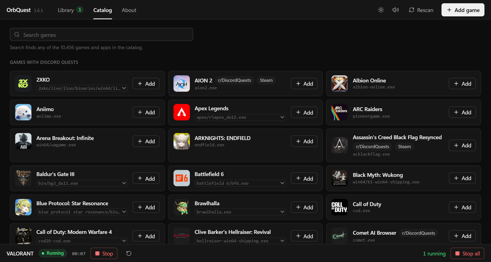

  

<h1 align="center">OrbQuest</h1>

  Local timer for Discord's play-a-game Quests on Windows.

  
  
  
  

  <a href="https://github.com/Ravan404/OrbQuest/releases/latest"><b>Download</b></a> ·
  <a href="#how-to-use-it">How to use it</a> ·
  <a href="#questions">Questions</a> ·
  <a href="docs/development.md">Development</a>

> [!WARNING]
> OrbQuest is not made by, endorsed by or affiliated with Discord Inc. Discord, Quests and Orbs are Discord's names for its own products. Running a stand-in program instead of the real game may break the rules of a quest or of Discord's Terms of Service. Discord has acted against quest automation since April 2026. In late August 2026 users reported quest access suspended for about two weeks for "Inauthentic Quest Completion", reportedly with a violation on the account's standing. According to those reports, renamed executables were caught, and closing a game exactly when the quest time ends may be flagged. **OrbQuest works in a similar way**, so not touching your token does not protect your account. Use it only at your own risk. See [the sources](docs/alternatives.md#what-users-have-reported).

## What it does

OrbQuest is for Discord's play-a-game quests when you do not want to install the game. It starts a small placeholder program under the game's `.exe` name, counts the time, and stops it when the timer ends. It never logs in to Discord, never reads your token and does not change the Discord client. A finished timer here is not proof that Discord counted the quest.

- The catalog is Discord's own list of about 10,400 games, so the placeholder gets exactly the name and folder Discord looks for. Quest programs the list has no executable for, such as Firefox or new quest games, come from r/DiscordQuests.
- Set a timer from 1 to 1440 minutes, or no limit. An interrupted run resumes, and the settings are kept.
- Quests Discord only detects through Steam, such as EA SPORTS FC 27, are set up in your Steam folder after you confirm it. A real install is never touched.
- A start script can run the real game instead and close it after the same timer.
- New versions are downloaded, checked against their SHA-256 and installed from inside the app.
- There is no account and no analytics. See the [privacy policy](PRIVACY.md).

## Download

Get one of these from the [latest release](https://github.com/Ravan404/OrbQuest/releases/latest). Both need Windows 10 or 11 (64-bit) and keep your library in the same place, so you can switch between them.

| File | What it is |
|---|---|
| `OrbQuest-Setup-<version>.exe` | **Recommended.** Installs for your Windows user, without administrator rights, with a Start menu entry. Starts in about a second. |
| `OrbQuest-<version>.exe` | Portable: one file that runs from any folder. It unpacks itself on every start, so it takes a few seconds longer. |

`SHA256SUMS.txt` in each release lets you check your download.

## How to use it

1. Keep Discord open and accept the quest there.
2. In OrbQuest, open **Catalog**, search for the game and click **Add**.
3. Set the time with the timer button on the card, then click **Launch**.
4. Check the quest in Discord: OrbQuest cannot see whether it counted.

## Questions

<b>Windows says the file is from an unknown publisher</b>

The files are not code-signed yet, so SmartScreen shows this for them: **More info → Run anyway**. See the [code signing policy](#code-signing-policy).

<b>My antivirus flags the placeholder</b>

Some antivirus programs flag it because it is a tiny program that runs under another game's name. Its source is [`placeholder/placeholder_runtime.c`](placeholder/placeholder_runtime.c), and CI checks that the committed program is built from exactly that source. **Rescan** in the app puts back a placeholder that was removed.

<b>Does it need my Discord account or token?</b>

No. It never logs in to Discord and never reads a token. All it does is start and stop a program on your PC.

<b>The timer finished but the quest did not count</b>

Discord only notices games while it is open, and OrbQuest cannot see the quest's state. Keep Discord running during the timer and check the quest there. For a Steam quest, close Steam and Discord completely and start them again.

<b>A game is not in the catalog</b>

Use **Add game** with its name and `.exe`. If a quest game has the wrong executable, [report it](https://github.com/Ravan404/OrbQuest/issues/new?template=catalog_problem.yml).

<b>Where are my files, and how do I remove everything?</b>

The library is in `%LOCALAPPDATA%\OrbQuest`; **Open folder** on the About page opens it. Uninstall from Installed apps, or delete the portable exe. Your library stays until you delete that folder too.

## Documentation

- [How it works](docs/how-it-works.md): the game database, files on disk and security
- [Alternatives and risks](docs/alternatives.md): other ways to do a quest, and what users have reported
- [Configuration](docs/configuration.md): settings for running it your own way
- [Development](docs/development.md): running from source, tests and building the packages
- [Changelog](CHANGELOG.md) · [Privacy](PRIVACY.md) · [Security](SECURITY.md)

## Code signing policy

The Windows files are not code-signed yet. Every release file is built from a tag of this repository by the [Release workflow](.github/workflows/release.yml), and each release is reviewed and published by hand.

- Committers and reviewers: [Ravan404](https://github.com/Ravan404)
- Approvers: [Ravan404](https://github.com/Ravan404)
- Privacy: see the [privacy policy](PRIVACY.md).

## Contributing

Bug reports, catalog fixes and pull requests are welcome: see [CONTRIBUTING.md](CONTRIBUTING.md) and the [code of conduct](CODE_OF_CONDUCT.md). Security problems: [SECURITY.md](SECURITY.md).

## License

[MIT](LICENSE)
