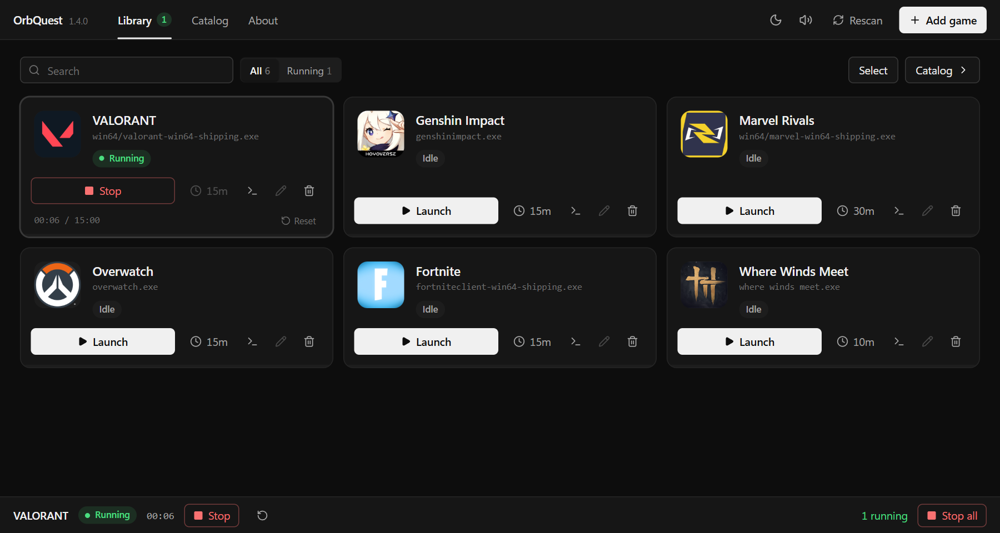

# OrbQuest

[](https://github.com/Ravan404/OrbQuest/actions/workflows/ci.yml)
[](LICENSE)

Local timer for Discord's play-a-game Quests, for Windows. It starts a small placeholder process under a game's `.exe` name, counts the time, and can stop that process when the timer ends. The games and their executables come from Discord's own list of detectable games, so the placeholder gets exactly the name and folder Discord looks for. Quest programs Discord's list has no executable for (browsers and other apps, brand-new quest games) are filled in from r/DiscordQuests.

It does not log into Discord, does not take a token, and does not change the Discord client. A finished timer here is not proof that Discord counted the quest.



> OrbQuest is not made by, endorsed by or affiliated with Discord Inc. Discord, Quests and Orbs are Discord's names for its own products. Running a stand-in program instead of the real game may break the rules of a quest or of Discord's Terms of Service. Since April 2026 users have reported Discord restricting quest access for "Inauthentic Quest Completion", with a warning on the account's standing. Use it only at your own risk.

## Download

Each [release](https://github.com/Ravan404/OrbQuest/releases/latest) has two files:

- **`OrbQuest-Setup-<version>.exe`**: installs OrbQuest for your Windows user, without administrator rights, into `%LOCALAPPDATA%\Programs\OrbQuest`, with a Start menu entry. It starts in about a second. Uninstall it from Installed apps.
- **`OrbQuest-<version>.exe`**: the portable version, one file that runs from any folder. It unpacks itself to `%TEMP%` on every start, so it takes a few seconds longer.

Both keep the library in `%LOCALAPPDATA%\OrbQuest`, so switching between them, or uninstalling, keeps your games. When a new release is out, an Update button appears next to the version at the top of the window: OrbQuest downloads the new version from this repository's releases, checks it against `SHA256SUMS.txt`, closes, and opens again with the new version. `SHA256SUMS.txt` also lets you check a download yourself.

The files are not code-signed, so Windows SmartScreen may say they are from an unknown publisher (More info → Run anyway). Some antivirus programs also flag the placeholder because it is a tiny program that runs under another game's name. The source of both is in this repository, and the release is built by GitHub Actions from it.

## Run from source

Node.js 22.12 or newer.

```bash
npm ci
npm run dev
```

The server listens on `http://127.0.0.1:3000`.

| Command | What it does |
|---|---|
| `npm run typecheck` | TypeScript check |
| `npm run lint` | Biome lint and format check (`npm run format` fixes the format) |
| `npm test` | Unit and API tests (`tests/`), offline, in a temporary folder |
| `npm run test:e2e` | Browser test of the built app in Edge or Chrome (Windows; run `npm run build` first) |
| `npm run build` | Frontend plus `dist/server.cjs` |
| `npm start` | Run the production server |
| `npm run verify:dist` | Boot the built server and check the offline database |
| `npm run update-database` | Rebuild `src/server/gameDatabase.json` from Discord's list and r/DiscordQuests (`-- --dry-run` only shows the changes) |
| `npm run clean` | Delete `dist/` and Vite's cache |

Windows packages:

```bat
build_windows_exe.bat
powershell -ExecutionPolicy Bypass -File scripts\smoke-test-package.ps1
```

The first writes `release\OrbQuest-Setup-<version>.exe` (with [Inno Setup 6](https://jrsoftware.org/isinfo.php)), `release\OrbQuest-<version>.exe` and `release\SHA256SUMS.txt`; the second installs, starts and uninstalls them. It needs a Windows machine with Python 3.13. Games and settings go in `%LOCALAPPDATA%\OrbQuest\Games`; versions before 1.5.0 kept that folder next to the exe and it is moved there on the first start. If startup fails, look at `%LOCALAPPDATA%\OrbQuest\startup.log`. The backend's own messages go to `backend.log` in the same folder (the previous run is kept as `backend.log.1`). The window needs the Microsoft Edge WebView2 runtime, which Windows 10 and 11 normally have; on a PC without it, put a Fixed Version runtime in a `WebView2Runtime` folder next to the exe.

The placeholder (`placeholder_runtime.exe`) is committed as a binary, and its build is reproducible: CI rebuilds it from `placeholder_runtime.c` with the pinned toolchain and fails if the result differs from the committed file by a single byte. See [CONTRIBUTING.md](CONTRIBUTING.md#the-placeholder-executable).

## Settings

Settings are environment variables; the app does not read a `.env` file. In PowerShell: `$env:PORT = 4000; npm run dev`.

| Variable | Default | Meaning |
|---|---|---|
| `PORT` | `3000` | HTTP port |
| `DQR_BIND_HOST` | `127.0.0.1` | Bind address. Use `0.0.0.0` only if you mean to share it on the LAN |
| `DQR_ALLOWED_HOSTS` | loopback names | Extra `Host` values, comma separated. `*.example.com` is allowed. A single `*` turns the check off |
| `DQR_RATE_LIMIT_MAX` | `100` | Catalog requests per IP per minute |
| `DQR_ROOT` | working directory | Where `Games/` and `icon-cache/` are written. The desktop build uses `%LOCALAPPDATA%\OrbQuest` |
| `DQR_GAMES_DIR` | `<DQR_ROOT>/Games` | The library folder itself |
| `DQR_ASSET_ROOT` | `DQR_ROOT` | Read-only files: `dist/` and `placeholder_runtime.exe` |
| `DQR_DATABASE_REFRESH` | unset | Background database update. Unset means every six hours. `1` forces one at boot. `0` never |
| `DQR_DATABASE_URL` | `src/server/gameDatabase.json` on this repository's `database` branch | Where the published game database is downloaded from. Point it at your fork's copy |
| `DQR_STEAMAPPS` | Steam's own `steamapps` | The Steam library Steam quests are written to |
| `DQR_DOWNLOADS_DIR` | Windows' Downloads folder | Where start scripts are saved |
| `DQR_UPDATE_CHECK` | unset | `0`: never ask GitHub for a new release |
| `DQR_OFFLINE` | unset | `1`: no network requests at all (database updates, icons, the release check; the full host list is in [SECURITY.md](SECURITY.md)). The bundled database and saved icons still work |
| `DQR_DEBUG` | unset | Any value: log failed icon downloads |
| `DQR_NODE_EXE` | `node.exe` on `PATH` | Build only: the Node.js runtime `build_windows_exe.bat` packs into the exe |

## What you can do in the app

- Search the catalog of every game Discord can detect, or pick one of the games that have had Discord quests, and add it with one click. When Discord lists several executables, the game's own is chosen and the others are in a list.
- Add a game Discord does not list yet by its name and `.exe`.
- Launch the placeholder, set a target (1 to 1440 minutes, or no limit), and let the server stop it.
- Resume an interrupted run. A completed counter goes back to `00:00` on the next start. The timer settings stay; the server saves them, so they survive a restart of the desktop app.
- Rescan picks up game folders you added by hand, drops ones you deleted, and puts back a placeholder that antivirus removed.
- Rename a custom or scanned entry and change its placeholder executable. Catalog entries only accept timer changes.
- Switch between the light and the dark theme with the button left of the sound switch; it shows the theme it switches to. The app follows Windows until the button is used, and keeps the choice.
- Add a quest Discord only detects through Steam, such as EA SPORTS FC 27 (marked Steam in the catalog). Steam has to be installed: the placeholder goes to `steamapps\common\<game>` of the Steam installation with a small `appmanifest_<id>.acf`, as the r/DiscordQuests post describes. A real install or manifest of the game is never overwritten, and removing the entry deletes only what the app wrote.
- Save a start script (`.bat`, `.ps1` or `.py`) that starts the real game and closes it after the same timer. It goes to your Downloads folder as `<Game> - OrbQuest.bat`.
- Open the library folder from the About page.

## Files on disk

Each library entry is a folder under `Games/`:

| File | What it is |
|---|---|
| `<name>.exe` | Placeholder copied in by the app (in the subfolder Discord expects, e.g. `win64\valorant-win64-shipping.exe`), or an executable you placed there |
| `.game-name.txt` | Display name |
| `.game-meta.json` | Where the entry came from (`custom`, `catalog`, or `scanned`), its executable path, its Discord application id and when it was added |
| `Games/.state.json` | Elapsed time and timer settings |
| `Games/.settings.json` | App settings: sound on/off, theme (`system`, `light` or `dark`) |
| `Games/.game-database.json` | The last downloaded game database, when it is newer than the one in the build |
| `Games/.special-games.json` | Steam quests, which live in the Steam library instead of `Games/` |
| `icon-cache/` | Saved game icons, next to `Games/` |

If two folder names would become the same id (`Foo Bar` and `Foo-Bar`), the second id is stored in `.game-meta.json` so both stay in the library.

## The game database

`src/server/gameDatabase.json` is Discord's list of detectable games (`discord.com/api/v9/applications/detectable`) in compact form: every game with a Windows executable, the executables with the folder part Discord matches, its other names and its icon id.

Discord also lists quest programs without any executable (Firefox, the Comet browser) and adds new quest games to its list late. For those the database takes the executable from r/DiscordQuests posts, marked `"source": "reddit"` and shown with an r/DiscordQuests label in the catalog. Such an entry is only used while Discord's list knows neither its executable nor the game; once Discord adds it, Discord's entry takes over. It keeps Discord's id and icon when Discord knows the program by name; a program Discord has no icon for (Firefox, Opera GX) gets its website in `"site"`, and the app shows that site's icon. A quest the post sets up through Steam keeps Steam's app id and folder in `"steam"`.

`src/server/featuredGames.json` names the games shown on the catalog page before anything is searched: the ones that have had Discord quests, plus every r/DiscordQuests entry.

Typing in the catalog searches this list in memory: exact names first, then names that start with or contain the text, then executable names. Nothing is sent over the network for a search.

The [Game database workflow](.github/workflows/database.yml) reads Discord's list and the r/DiscordQuests posts newer than the snapshots in `data/reddit/` (through the Arctic Shift archive when Reddit refuses) every six hours, checks that the list did not suddenly lose many games, runs the tests and publishes `gameDatabase.json` and the snapshots on the [`database` branch](https://github.com/Ravan404/OrbQuest/tree/database) when something changed. That branch holds a single commit that each update replaces; releases are built with its database. The app itself never asks Reddit. Every install downloads that file every six hours, from `raw.githubusercontent.com` or, if that fails, jsDelivr, with an ETag so an unchanged file is not sent again. A downloaded database that is newer than the one in the build replaces it and is kept in `Games/.game-database.json`, so it works offline too. Only when the file cannot be downloaded for a day does the app read Discord's list itself.

```bash
npm run update-database              # rebuild gameDatabase.json from Discord's list and r/DiscordQuests
npm run update-database -- --dry-run # show what would change, write nothing
```

A post the extractor reads wrongly gets a fix in `src/server/reddit/corrections.ts`. Anything still missing can be added by hand with Add game.

## Layout

```
server.ts                  Express app
src/App.tsx                UI state and actions
src/views/                 Library, Catalog, About
src/components/            Cards, bars, timer menu, shared controls (ui.tsx)
src/dialogs/               Add/edit game, start script, update
src/hooks/, src/utils/     Polling, timer maths, start scripts, executable choice
src/strings.ts             Every text the window shows
src/index.css              Light and dark theme colours
src/server/                Game database, catalog, icons, Steam quests, session, updates
src/server/library/        The library: scan, saved timers, placeholder processes
src/server/routes/         The HTTP API
src/server/gameDatabase.json  Discord's list of detectable games (compact)
src/server/featuredGames.json Games shown before a search
src/server/reddit/         Reads r/DiscordQuests for the database update (not part of the app)
data/reddit/               r/DiscordQuests post snapshots
tests/                     node:test suites (npm test); tests/e2e/ is the browser test
scripts/                   Test runner, database update, release checks, package smoke test
desktop_app.py             Windows window (pywebview), with single_instance.py
OrbQuest.spec              PyInstaller recipe for the installed files and the portable exe
installer/OrbQuest.iss     Inno Setup script for the installer
placeholder_runtime.c      Placeholder process (Win32, committed as placeholder_runtime.exe)
placeholder_runtime.py     Placeholder fallback for development on Linux/macOS
requirements-build.txt     Python packages for build_windows_exe.bat
assets/                    App icon: icon.svg (source) and OrbQuest.ico (exe and window)
public/                    favicon.svg, copied into dist/ by the build
docs/                      Screenshot for this README
```

## Security

- Binds to `127.0.0.1` unless `DQR_BIND_HOST` says otherwise.
- In the desktop app only its own window can use the API: the window opens with a token that is new on every start and keeps it as an HttpOnly cookie. Another program on the PC cannot start or remove games through it.
- Rejects a `Host` header that is not loopback, unless `DQR_ALLOWED_HOSTS` allows it. That blocks a page from calling this API by pointing its own hostname at `127.0.0.1`.
- Production builds send a Content-Security-Policy. The dev server does not, so the Vite client can connect.
- `dist/server.cjs`, its sourcemap and the database JSON files are not served as static files.
- File writes stay inside `Games/` and `icon-cache/`, for a Steam quest inside that game's folder and manifest in Steam's `steamapps`, and a start script only as `<Game> - OrbQuest.<bat|ps1|py>` in Downloads. An executable path from a request or from Discord's list must stay inside its game folder (no `..`, drive letters or absolute paths).
- Images are only loaded from the app itself and `cdn.discordapp.com`. A website icon is downloaded by the server and served from `icon-cache/`.
- An update is only downloaded from this repository's releases, must match the SHA-256 in the release's `SHA256SUMS.txt`, and is checked again by the desktop app before it runs.

## Contributing

See [CONTRIBUTING.md](CONTRIBUTING.md). Security problems: [SECURITY.md](SECURITY.md).

## License

[MIT](LICENSE)
