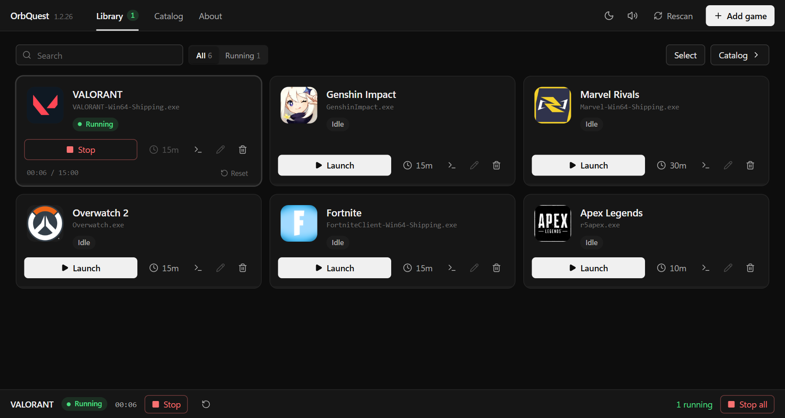

# OrbQuest

[](https://github.com/Ravan404/OrbQuest/actions/workflows/ci.yml)
[](LICENSE)

Local timer for Discord's play-a-game Quests, for Windows. It starts a small placeholder process under a game's `.exe` name (or an executable you put in the game's folder), counts the time, and can stop that process when the timer ends.

It does not log into Discord, does not take a token, and does not change the Discord client. A finished timer here is not proof that Discord counted the quest.



> OrbQuest is not made by, endorsed by or affiliated with Discord Inc. Discord, Quests and Orbs are Discord's names for its own products. Running a stand-in program instead of the real game may break the rules of a quest or of Discord's Terms of Service. Since April 2026 users have reported Discord restricting quest access for "Inauthentic Quest Completion", with a warning on the account's standing. Use it only at your own risk.

## Download

Get `OrbQuest.exe` from the [latest release](https://github.com/Ravan404/OrbQuest/releases/latest) and run it. No install is needed; it keeps its `Games` folder next to the exe. Each release lists the SHA-256 of the file (`OrbQuest.exe.sha256`).

The exe is not code-signed, so Windows SmartScreen may say it is from an unknown publisher (More info → Run anyway). Some antivirus programs also flag the placeholder because it is a tiny program that runs under another game's name. The source of both is in this repository, and the release is built by GitHub Actions from it.

## Run from source

Node.js 22.12 or newer.

```bash
npm ci
npm run dev
```

The server listens on `http://127.0.0.1:3000`.

| Command | What it does |
|---|---|
| `npm run typecheck` | TypeScript check |
| `npm test` | Unit and API tests (`tests/`), offline, in a temporary folder |
| `npm run build` | Frontend plus `dist/server.cjs` |
| `npm start` | Run the production server |
| `npm run verify:dist` | Boot the built server and check the offline database |
| `npm run update-database` | Pull newer r/DiscordQuests posts and rebuild the local database |
| `npm run icons:download` | Fetch an icon for each database game into `public/game-icons/` (needs internet, commit the result) |
| `npm run build-reddit-cache` | Rebuild `src/server/redditCache.json` from the snapshots in `data/reddit/`, no network |
| `npm run clean` | Delete `dist/` and Vite's cache |

Windows package:

```bat
build_windows_exe.bat
```

That writes `dist\OrbQuest.exe`. It needs a Windows machine. Games and settings go in a `Games` folder next to the exe. If startup fails, look at `%LOCALAPPDATA%\OrbQuest\startup.log`. The backend's own messages go to `backend.log` in the same folder (the previous run is kept as `backend.log.1`). The window needs the Microsoft Edge WebView2 runtime, which Windows 10 and 11 normally have; on a PC without it, put a Fixed Version runtime in a `WebView2Runtime` folder next to the exe.

The placeholder (`placeholder_runtime.exe`) is committed as a binary. To rebuild it from `placeholder_runtime.c`, install MinGW-w64 and run `scripts\build-placeholder.bat`, then add the old file's SHA-256 to `LEGACY_SHA256_HASHES` in `src/server/placeholderUpgrade.ts` so existing copies are upgraded.

## Settings

Settings are environment variables; the app does not read a `.env` file. In PowerShell: `$env:PORT = 4000; npm run dev`.

| Variable | Default | Meaning |
|---|---|---|
| `PORT` | `3000` | HTTP port |
| `DQR_BIND_HOST` | `127.0.0.1` | Bind address. Use `0.0.0.0` only if you mean to share it on the LAN |
| `DQR_ALLOWED_HOSTS` | loopback names | Extra `Host` values, comma separated. `*.example.com` is allowed. A single `*` turns the check off |
| `DQR_RATE_LIMIT_MAX` | `100` | Catalog and search requests per IP per minute |
| `DQR_ROOT` | working directory | Where `Games/` and `icon-cache/` are written. The desktop build sets this to the exe folder |
| `DQR_GAMES_DIR` | `<DQR_ROOT>/Games` | The library folder itself |
| `DQR_ASSET_ROOT` | `DQR_ROOT` | Read-only files: `dist/` and `placeholder_runtime.exe` |
| `DQR_REDDIT_CACHE_REFRESH` | unset | Background database update. Unset means every six hours. `1` forces one at boot. `0` never |
| `DQR_DATABASE_URL` | this repository's `src/server/redditCache.json` | Where the published quest database is downloaded from. Point it at your fork's copy |
| `DQR_OFFLINE` | unset | `1`: no network requests at all (icons, Reddit, Discord's game list; the full host list is in [SECURITY.md](SECURITY.md)). The local database and bundled icons still work |
| `DQR_REDDIT_USER_AGENT` | `desktop:com.orbquest:v<version> (+<repo url>)` | User-Agent for Reddit requests. Set your own if you ship a fork |
| `DQR_DEBUG` | unset | Any value: log each icon lookup |
| `DQR_NODE_EXE` | `node.exe` on `PATH` | Build only: the Node.js runtime `build_windows_exe.bat` packs into the exe |

## What you can do in the app

- Add a game from the catalog, or type your own name and `.exe`.
- Launch the placeholder, set a target (1 to 1440 minutes, or no limit), and let the server stop it.
- Resume an interrupted run. A completed counter goes back to `00:00` on the next start. The timer settings stay; the server saves them, so they survive a restart of the desktop app.
- Rescan picks up game folders you added by hand, drops ones you deleted, and puts back a placeholder that antivirus removed.
- Rename a custom or scanned entry and change its placeholder executable. Catalog entries only accept timer changes. A Steam-manifest install can be renamed, but its folder and executable stay.
- Search the local quest database while typing. Reddit is only asked after Enter or Search Reddit.
- Switch between a light and a dark theme, or follow the Windows setting (the button left of the sound switch).
- For a Steam-manifest quest, write a placeholder install into the detected Steam `steamapps` folder. A real manifest or a real game folder is left alone. Removing the entry deletes only the placeholder install the app wrote.

## Files on disk

Each library entry is a folder under `Games/`:

| File | What it is |
|---|---|
| `<name>.exe` | Placeholder copied in by the app, or an executable you placed there |
| `.game-name.txt` | Display name |
| `.game-meta.json` | Where the entry came from (`custom`, `catalog`, or `scanned`) and when it was added |
| `Games/.state.json` | Elapsed time and timer settings |
| `Games/.settings.json` | App settings: sound on/off, theme (`system`, `light` or `dark`) |
| `Games/.special-games.json` | Steam-manifest installs the app wrote into a Steam library |

If two folder names would become the same id (`Foo Bar` and `Foo-Bar`), the second id is stored in `.game-meta.json` so both stay in the library.

A Steam-manifest add uses the `installdir` from the manifest. It does not rename that folder to `Name (2)`.

## Search order

Typing in the catalog only searches locally.

1. Recent searches, kept in memory by the server.
2. Local quest database (`src/server/redditCache.json` plus the curated list in `src/server/questDatabase.ts`). One card per game.
3. Live Reddit, only when the database has nothing for that game, and only after Enter or Search Reddit.

Search Reddit always asks Reddit and puts new results under the database results. The same executable is not listed twice.

Reddit requests go through `src/server/redditClient.ts`: one at a time, a gap between them, at most 8 per minute. A 429 is not retried.

## How the database stays up to date

The app does not ask Reddit for new quests itself. The [Quest database workflow](.github/workflows/database.yml) reads new r/DiscordQuests posts every six hours (through the Arctic Shift archive when Reddit refuses), checks the result, runs the tests and commits the rebuilt `src/server/redditCache.json` to `main` when something changed. Every install downloads that one file every six hours, from `raw.githubusercontent.com` or, if that fails, jsDelivr, with an ETag so an unchanged file is not sent again. Reddit therefore sees a few requests a day in total, however many people use the app.

A downloaded database that is newer than the one in the build replaces it and is kept in `Games/.quest-database.json`, so it works offline too. Only when the file cannot be downloaded for a day does the app read new posts from Reddit itself.

A game added from a live Reddit result is saved to `Games/.quest-database.json` so the next search can find it offline. Only results the server itself received are saved.

## Rebuilding the quest database

```bash
npm run update-database                              # fetch new r/DiscordQuests posts
npm run update-database -- --dry-run                 # show what would change, write nothing
npm run build-reddit-cache                           # rebuild from the committed snapshots
npm run build-reddit-cache -- path/to/dataset.json   # rebuild from that one file only (Apify reddit-scraper format)
```

`update-database` reads posts newer than the newest one already checked and writes `data/reddit/dataset_reddit-update_<date>.json`. The workflow above runs it on a schedule; run it by hand only to test a change, and review `git diff src/server/redditCache.json`. Fixes for misread posts go in `src/server/redditCorrections.ts`.

Update dates live in `src/server/questDatabaseInfo.ts`. The About page shows the last one; `GET /api/profile` returns all of them as `questDatabase`.

## Layout

```
server.ts                  Express app
src/App.tsx                UI state and actions
src/views/                 Library, Catalog, lookup results, About
src/components/            Cards, bars, timer menu, shared controls (ui.tsx)
src/dialogs/               Add/edit game, start script
src/hooks/, src/utils/     Polling, timer maths, start scripts, catalog search
src/strings.ts             Every text the window shows
src/index.css              Light and dark theme colours
src/server/                Library, catalog, Reddit, Steam checks, icons
src/server/redditCache.json  The bundled quest database
public/game-icons/         Bundled game icons
tests/                     node:test suites (npm test)
scripts/                   Test runner, database update, icon download, release checks
desktop_app.py             Windows window (pywebview), with single_instance.py
OrbQuest.spec       PyInstaller recipe for the exe
placeholder_runtime.c      Placeholder process (Win32, committed as placeholder_runtime.exe)
placeholder_runtime.py     Placeholder fallback for development on Linux/macOS
process-apify.ts           Builds the quest database from the snapshots
catalog_cache.json         General game names
data/reddit/               r/DiscordQuests snapshots the quest database is built from
requirements-build.txt     Python packages for build_windows_exe.bat
docs/                      Screenshot for this README
```

## Security

- Binds to `127.0.0.1` unless `DQR_BIND_HOST` says otherwise.
- Rejects a `Host` header that is not loopback, unless `DQR_ALLOWED_HOSTS` allows it. That blocks a page from calling this API by pointing its own hostname at `127.0.0.1`.
- Production builds send a Content-Security-Policy. The dev server does not, so the Vite client can connect.
- `dist/server.cjs`, its sourcemap, `redditCache.json` and `discordIconCatalog.json` are not served as static files.
- File writes stay inside `Games/` and `icon-cache/`, except a Steam-manifest install, which only writes a placeholder the app created.
- Only `http` and `https` links from Reddit text are made clickable.

## Contributing

See [CONTRIBUTING.md](CONTRIBUTING.md). Security problems: [SECURITY.md](SECURITY.md).

## License

[MIT](LICENSE)
